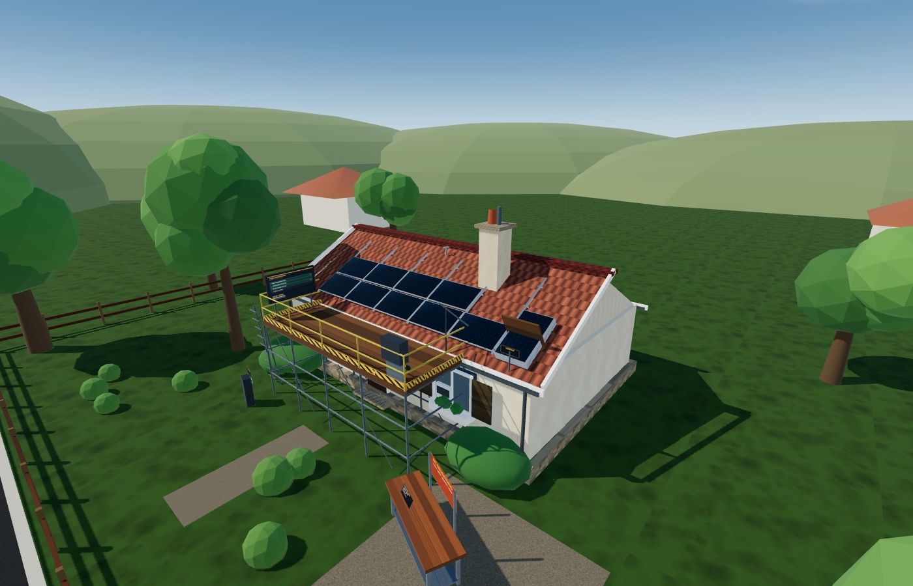
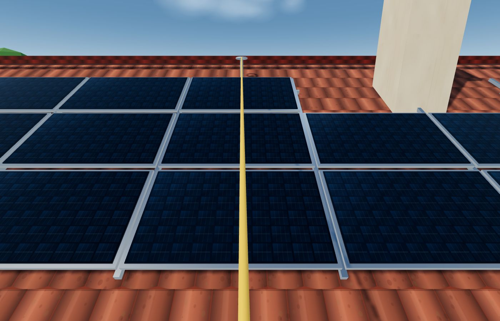
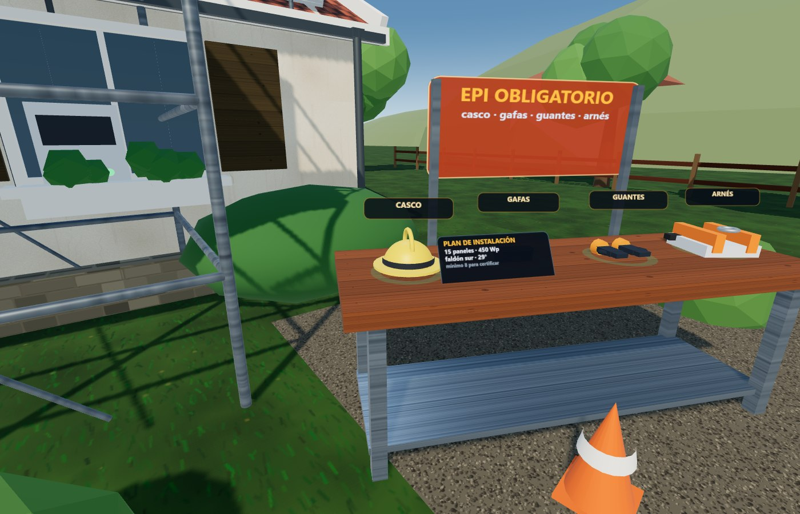
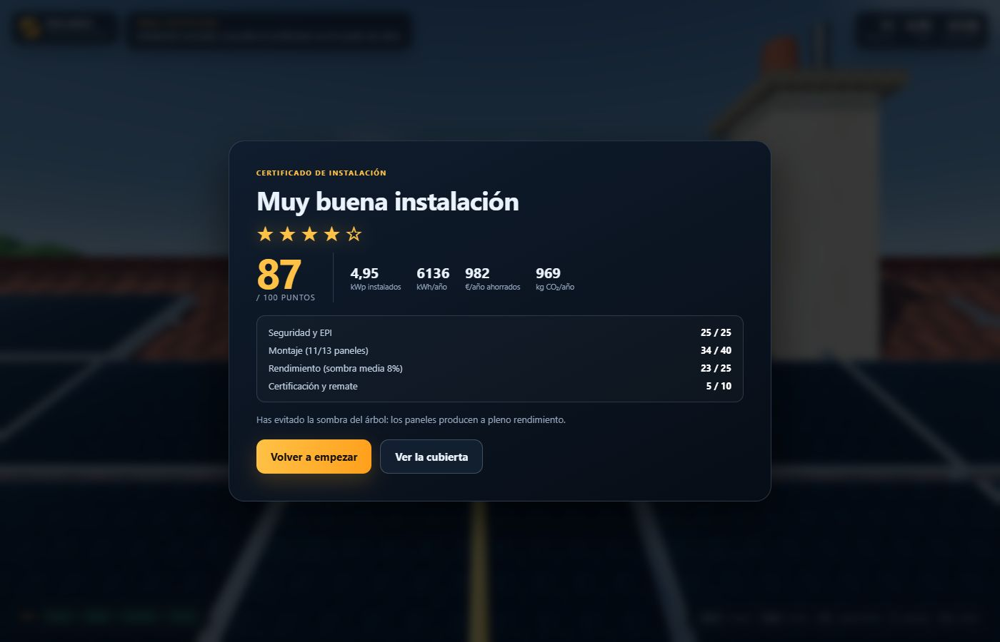

# Tejado Solar VR

Simulador **WebXR** de instalación de paneles solares sobre la cubierta de una vivienda.
Pensado para jugar de pie en **Pico 4** (navegador del visor) y también en el ordenador.

**[▶ Jugar ahora](https://jrubioastigarraga.github.io/tejado-solar-vr/)**



Ponte el EPI, sube al andamio, camina por el faldón sur, monta los paneles sobre las
guías, evita la sombra del árbol y certifica la instalación. Al final obtienes la
producción anual estimada, el ahorro y la nota de la obra.

## Jugar en Pico 4

### Opción A · APK (recomendada, sin navegador)

Descarga **[TejadoSolarVR-pico4.apk](https://github.com/jrubioastigarraga/tejado-solar-vr/releases/latest/download/TejadoSolarVR-pico4.apk)**
e instálala en el visor. La APK lleva dentro la escena, Three.js y un servidor local, así que
funciona sin Internet. Al abrirla se lanza el navegador del Pico con la experiencia ya cargada
(pulsa **Entrar en VR**). Si el navegador no arranca solo, la pantalla de la app tiene
**Entrar en VR (navegador)**, **Elegir navegador…** y **Ver en 2D**.

Instalación por USB:

```powershell
adb install -r TejadoSolarVR-pico4.apk
```

Luego en el visor: **Biblioteca → Desconocidas → Tejado Solar VR**.
La APK está firmada con una clave propia que se guarda fuera del repositorio (ver [APK para Pico 4](#apk-para-pico-4)).

### Opción B · Navegador

1. Conecta el visor a Internet y abre el **navegador del Pico 4**.
2. Entra en <https://jrubioastigarraga.github.io/tejado-solar-vr/>.
3. Pulsa **Entrar en VR** y acepta la sesión inmersiva.
4. Permanece de pie y con espacio alrededor: el juego usa escala real (1:1) y
   `local-floor`. Los mandos son 6DoF.

> WebXR exige un contexto seguro: GitHub Pages sirve la página por HTTPS.
> Si abres el proyecto en local, usa `http://localhost` (también es contexto seguro).

### Controles en VR

| Acción | Mando |
| --- | --- |
| Coger / soltar (paneles, EPI, pulsadores) | Gatillo |
| Moverte | Stick izquierdo |
| Girar 30° | Stick derecho (izquierda/derecha) |
| Equiparte el EPI que llevas en la mano | **A / X** (o acércalo a la cara) |
| Soltar lo que llevas | Gatillo / palma |

### Controles en pantalla

`WASD` mover · ratón mirar (clic en la escena para capturar el puntero) ·
clic coger/soltar · `E` equipar el EPI apuntado · `Esc` soltar.

## Cómo se juega

1. **EPI (fase 1).** En la mesa de obra hay casco, gafas, guantes y arnés. Cógelos y
   llévalos al cuerpo. El acceso a la cubierta está bloqueado hasta que estén los cuatro.
2. **Acceso.** Pulsa el pulsador verde junto a la escalera. Subes al andamio y entras en
   la cubierta. El arnés queda unido a la línea de vida del anclaje de cumbrera.
3. **Montaje.** Coge paneles del stock (16 unidades, 450 Wp) y acércalos a las guías.
   Cuando el marco del panel se pone verde, suelta: queda fijado. Puedes retirar uno ya
   montado cogiéndolo de nuevo.
4. **Sombra.** El faldón tiene 15 huecos; la chimenea ocupa 2. El árbol del jardín proyecta
   sombra sobre dos huecos del extremo oeste: producen aproximadamente la mitad. El HUD de
   muñeca muestra la sombra y los kWh/año del hueco que estás apuntando.
5. **Certificación.** Con un mínimo de 8 paneles, pulsa **CERTIFICAR** en el cuadro del
   andamio. Obtienes estrellas, kWp, kWh/año, ahorro y CO₂ evitado.





## Qué se simula

- Vivienda de 12 × 8 m, cubierta a dos aguas con **29° de inclinación** y faldón sur.
- Paneles de **1,75 × 1,05 m** y **450 Wp** (21,5 kg), montaje coplanar sobre guías de aluminio.
- Separación entre paneles, retranqueo de bordes y hueco ocupado por la chimenea.
- Sombras reales (sol del suroeste) y cálculo por hueco con **1.350 kWh/kWp·año**.
- Precio de la luz **0,16 €/kWh** y factor de emisión **0,158 kg CO₂/kWh** (valores didácticos).
- EPI, línea de vida, andamio con barandilla y rodapié, prohibición de trabajar sin protección.
- Sonido procedural (sin archivos externos), materiales PBR y texturas generadas por canvas.

> Es un proyecto **didáctico**: los valores energéticos son orientativos y no sustituyen un
> estudio de sombras, un cálculo de estructuras ni la formación real en prevención de riesgos.

## Desarrollo

```bash
npm install
npm run dev     # esbuild en modo watch + servidor en http://localhost:5173
npm run build   # genera dist/ listo para publicar
```

Sin frameworks: **Three.js** (WebXR), módulos ES y `esbuild`. Todo el arte es procedural,
así que no hay que descargar modelos ni texturas.

### APK para Pico 4

El contenedor Android está en `android/`. Es un lanzador que:

1. Sirve la web compilada (`dist/`) desde un **servidor HTTP local** en `127.0.0.1:8741`
   (contexto seguro para WebXR, sin Internet).
2. Abre el **navegador del visor** con un `Intent`, que es quien aporta la sesión inmersiva.
3. Mantiene el servidor vivo con un **servicio en primer plano**.
4. Incluye un **modo 2D** en WebView como respaldo.

```powershell
cd android
.\build.ps1             # npm run build + APK firmada en ..\release\TejadoSolarVR-pico4.apk
.\build.ps1 -Install    # además la instala por adb
.\build.ps1 -SkipWeb    # reutiliza dist/
```

Requiere JDK 17/21 y Android SDK (platform 34). Los assets se copian solos con la tarea
Gradle `syncWebAssets`.

Para firmar el APK, crea `android/local.properties` (no se sube al repositorio) con tus
credenciales; también puedes usar las variables de entorno equivalentes:

```properties
sdk.dir=C\:\\ruta\\al\\Android\\Sdk
tejadosolar.storeFile=app/keystore/tejadosolar-release.jks
tejadosolar.storePassword=TU_CONTRASENA
tejadosolar.keyAlias=tejadosolar
tejadosolar.keyPassword=TU_CONTRASENA
```

| Variable de entorno | Propiedad |
| --- | --- |
| `TEJADOSOLAR_STORE_FILE` | `tejadosolar.storeFile` |
| `TEJADOSOLAR_STORE_PASSWORD` | `tejadosolar.storePassword` |
| `TEJADOSOLAR_KEY_ALIAS` | `tejadosolar.keyAlias` |
| `TEJADOSOLAR_KEY_PASSWORD` | `tejadosolar.keyPassword` |

Guarda el keystore y su contraseña fuera del repositorio (gestor de contraseñas o copia
segura): sin ellos no podrás firmar actualizaciones que se instalen encima.

```
index.html            interfaz de inicio, HUD y resultados
src/main.js           renderer, arranque, sesión XR y bucle
src/player.js         rig VR, mandos, locomoción, giro y modo ratón/teclado
src/house.js          casa, cubierta, guías, ventanas y chimenea
src/world.js          cielo, sol, terreno, árboles, andamio, EPI y cuadro de obra
src/solar.js          paneles, huecos, retícula, colocación y energía
src/ppe.js            equipos de protección y comprobaciones
src/interactions.js   rayos de los mandos y pulsadores
src/hud.js            HUD DOM y paneles 3D (muñeca, cartel, avisos, modales)
src/game.js           fases, validaciones, puntuación y línea de vida
src/optimize.js       fusión de malla estática para reducir draw calls
```

### Rendimiento

La escena baja de ~750 a ~290 draw calls fusionando geometría estática por material,
usa una sola luz con sombras de 2048 px y limita el pixel ratio. En Pico 4 se activa
foveación fija (0,65) al entrar en VR.

### Depuración

`?skipintro=1` entra directamente. `?view=drone`, `?view=roof`, `?view=platform`,
`?view=bench` o `?view=results` colocan la cámara de revisión. `?panels=9` monta paneles
de prueba y `?nohud=1` oculta el HUD.

## Despliegue

El sitio se publica en GitHub Pages desde la rama `gh-pages`:

```bash
npm run deploy
```

Ese comando compila `dist/` y la sube a `gh-pages` con `gh-pages`.
También se puede publicar con una acción de GitHub Actions; si tu token de `gh` tiene
el scope `workflow`, basta con añadir un workflow que compile y suba `dist/`.

## Licencia

MIT · Proyecto didáctico de FP (energía solar y prevención de riesgos).
